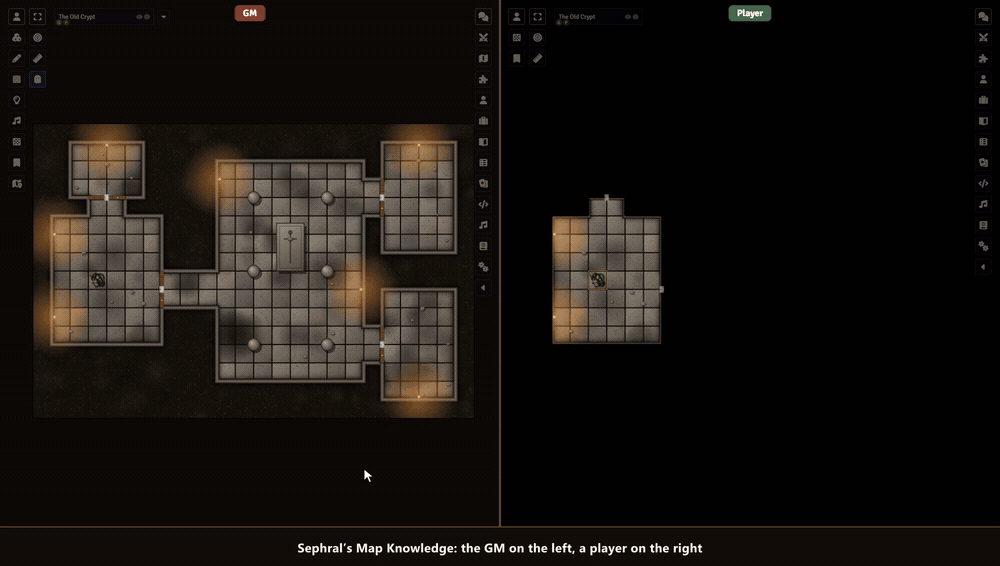

# Sephral’s Map Knowledge

**The party found the old map of the dungeon, or the scout came back and drew what she saw. In Foundry the players still stare at black fog until their tokens walk every corridor. Map Knowledge lets you mark parts of the map as known, for everyone or for chosen players, while token vision keeps working.**

## Highlights

* **Draw what they know:** drag a rectangle or an ellipse, click the corners of a polygon, and the area is explored for your players. They see the map there in the remembered fog color, monsters stay hidden until real sight reaches them.
* **A whole room with one click:** click into a room and the walls are its border, closed doors and windows included.
* **For the right players:** reveal for everyone or only for the elf who knows the forest. Players who are offline get it on their next visit.
* **Cover it again:** switch to hide, or hold Alt while you draw, and the players forget an area. Undo takes your last change back.
* **See what they know:** a tint shows on your map what the chosen players do not know yet, for the whole group or one player.
* **The scout tells the others:** give the chosen players everything one player knows of this Level.
* **Triggered by a Region:** a token walks through the gate and the hall behind it becomes known, once or every time.
* **Levels and shared fog:** works per Level of a scene and with Foundry’s shared fog of war.

## How it works

1. Open a scene with token vision and fog exploration, and pick *Map Knowledge* in the scene controls.
2. Choose who learns it in the window: all players or the chosen ones.
3. Drag, click corners or click into a room. Done, the players see the area as explored.

## Good to know

Map Knowledge writes into Foundry’s own fog of war, so it needs a scene with token vision and fog exploration. It runs on Foundry 14.

## Install

Search for **Map Knowledge** in Foundry's module browser or open the [package page](https://foundryvtt.com/packages/sephrals-map-knowledge).

Foundry VTT 14 · any game system · English and German

## Learn more

Every tool, setting and the macro API are explained in the [manual](MANUAL.md). Questions or ideas? Join us on [Discord](https://discord.gg/7BjCgDYaBP). Looking for more? See [all modules by Sephral](https://github.com/Sephral).

## License

See [LICENSE.md](LICENSE.md).
